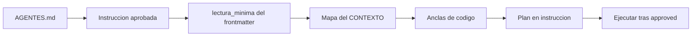

# Eficiencia IA — consumo mínimo de tokens

Reglas para que agentes y humanos lean **solo lo indispensable** antes de planificar, implementar o ajustar.

## Principio

La **instrucción aprobada** es el contrato de lectura: lista cerrada de docs y anclas de código. Si un archivo no está en esa lista (ni en el mapa del CONTEXTO citado), **no se abre**.

## Presupuesto por defecto (por tarea) — regla [R-06](../PROTOCOLO.md)

| Recurso | Máximo |
|---------|--------|
| Instrucciones | 1 (la de la tarea: `02-en-progreso/YYYY-MM-DD/`) |
| `CONTEXTO.md` | 1 por área declarada |
| Fichas `15-rutas/` | 3 |
| `50-sistema-integral/` (lectura) | **0** por defecto; ≤3 solo si `espejo_leer` o `lectura_minima` |
| `50-sistema-integral/` (escritura) | Paths en `espejo_actualizar` al cerrar (no cuenta en presupuesto de lectura) |
| `35-herramientas/autorizadas/` | ≤2 (solo al ejecutar excepción) |
| `35-herramientas/propuestas/` | IA escribe vía instrucción en `01-pendientes/`; no leer salvo revisión humana |
| `45-mejoras-propuestas/` | Escritura al cerrar instrucción (≤3) en `01-pendientes/YYYY-MM-DD/`; **no leer** salvo revisión de pendientes |
| ADR | 1 (solo si aplica al dominio: `03-completadas/`) |
| Auditoría `02-en-progreso/` | 1 (solo si investiga) |
| Archivos de código (anclas) | 5 (ampliable a 7–10 solo con R-21) |
| **Total docs** | **8** |
| Núcleo (`00-nucleo/`) | 0–2 archivos, **solo si** la instrucción o CONTEXTO los nombran |
| `ESTADO.md` | 1 (opcional, al entrar, para orientación rápida) |

Ampliar presupuesto → actualizar la instrucción y pedir aprobación humana.

**Más de 5 archivos de código (R-21).** Primero decidir si la ampliación es *sumamente necesaria*: ¿hay un subconjunto de ≤5 archivos entregable solo, compilando y sin contratos rotos? Si lo hay → **fraccionar** en instrucciones hijas de ≤5 (`fraccion_de`, `depende_de`). Si no → **ampliar** con `ampliacion_factor` 1.5–2 (tope 7–10), `ampliacion_justificacion` y aprobación humana **antes** de codear. Detalle: [ampliacion-alcance.md](ampliacion-alcance.md).

**No reabrir en la misma sesión.** Documento ya abierto en esta sesión no
se vuelve a abrir (ni docs ni anclas de código); se cita de memoria de la
sesión. Releer solo si el archivo cambió en disco desde su lectura.

## Matriz «¿Qué leer?»

| Tipo de tarea | Operativa (`25`, `15`, ADR, audit) | Espejo (`50`) | Herramientas (`35`) | Excepción sin instrucción |
|---------------|-------------------------------------|---------------|---------------------|---------------------------|
| Implementar feature | Sí — `lectura_minima` + CONTEXTO | Escribir `espejo_actualizar`; leer solo si citado | No (salvo propuesta al cerrar) | No |
| Deuda fuera de alcance detectada | No leer cola 45 | No | No | **Registrar** ficha en `01-pendientes/` al cerrar; no implementar |
| Solo documentación | Sí — instrucción solo-docs | Escribir paths citados | No | No |
| Ejecutar script/check autorizado | Ficha herramienta | Solo si ficha lo cita | Sí — ficha autorizada | **Sí** |
| Revisión de decisiones pendientes | No leer cola salvo revisión de pendientes | No | Sí — [`decisiones-pendientes`](../35-herramientas/autorizadas/decisiones-pendientes.md) | **Sí** (humano) |
| Onboarding / «¿dónde está X?» | CONTEXTO + 1 doc | ≤3 en `espejo_leer` | No | Solo lectura |
| Generar espejo integral | Meta + raíces | Leer raíces; escribir masivo | No | No (requiere instrucción) |
| Consolidar espejo (doc general) | Registro + huecos cerrados | Escribir solo faltantes | No | No |
| Investigar bug | CONTEXTO + audit `02-en-progreso` | Solo si citado | No | No |
| Pregunta solo lectura | AGENTES + CONTEXTO si área nombrada | ≤1 si humano pide mapa | No | Solo lectura |

## Fases (orden fijo)

| Fase | Qué leer | Qué no |
|------|----------|--------|
| 0 | `AGENTES.md` (raíz) + `ESTADO.md` si existe | Resto de docs |
| 1 | Instrucción de la tarea (`02-en-progreso/YYYY-MM-DD/`) | Historial de `05-instrucciones/` |
| 2 | Paths en `lectura_minima` | Índices completos, `90-archivo/` |
| 3 | Mapa de lectura del CONTEXTO | Otros CONTEXTO |
| 4 | Solo anclas listadas | Explorar repo, `grep` masivo |
| 5 | Escribir plan en instrucción → `awaiting_approval` | Editar código |
| 6 | Tras `approved`: implementar | Releer docs ya procesados |

## Planificación antes de implementar

Al recibir una orden de ejecución, el agente **primero** crea o actualiza la instrucción (en `05-instrucciones/01-pendientes/YYYY-MM-DD/`, R-17) con:

1. **Pedido** — 3–5 viñetas máximo.
2. **Lectura mínima** — lista cerrada de paths (frontmatter + sección).
3. **Anclas de código** — rutas concretas; preferir rango de líneas.
4. **`espejo_actualizar`** — paths del espejo a escribir al cerrar (desde anclas).
5. **`espejo_leer`** — casi siempre vacío.
6. **Plan de ejecución** — pasos numerados, sin prosa larga.
7. **Alcance excluido** — qué no tocar (reduce deriva).

Estado `awaiting_approval` hasta confirmación humana. **Sin `approved` → cero ediciones de código.**

## Reglas de lectura de código

- Abrir **solo** paths en `anclas_codigo` o sección Código ancla del CONTEXTO/ficha.
- Usar lectura parcial (offset/limit) en archivos grandes.
- No pegar archivos enteros en el chat; citar path:línea.
- No ejecutar búsquedas amplias (`**/*`, volcar árbol) salvo bloqueo documentado en auditoría activa.

## Espejo integral — leer vs escribir

| Acción | Regla |
|--------|-------|
| **Leer** | Solo paths en `espejo_leer` o `lectura_minima` (≤3). Default: **ninguno**. |
| **Escribir** | Paths en `espejo_actualizar` al cerrar la instrucción. |
| **Prohibido** | Glob/list masivo en `50-sistema-integral/`; leer espejo “para orientarse”. |

| Situación | ¿Leer espejo? |
|-----------|---------------|
| Implementar con CONTEXTO + anclas | No |
| Humano pide “¿dónde está X?” | Sí, 1 `README.md` en `espejo_leer` |
| Generar espejo completo | Sí, meta + raíces (plantilla dedicada) |
| Tras cambio de código | **Escribir** `espejo_actualizar`; no releer todo |
| Ejecutar herramienta autorizada | Leer solo su ficha + anclas; **sin instrucción nueva** |
| Propuesta IA | No ejecutar; humano promueve o rechaza |

## Herramientas — ¿Ejecutar sin instrucción?

| Situación | ¿Instrucción? |
|-----------|---------------|
| Cambio de producto / feature | Sí |
| Herramienta en `autorizadas/` + alcance coincide | **No** (excepción) |
| Código sugerido en `propuestas/` | Sí (o promover primero) |

Estrategia: [estrategia-instrucciones.md](estrategia-instrucciones.md).

## Reglas de escritura documental

- `CONTEXTO.md`: 60–120 líneas; índices y anclas, no copiar código.
- Ficha `15-rutas/`: plantilla estándar; sin OpenAPI completo.
- Instrucción: plan conciso; Resultado con operativa **y** espejo al cerrar.
- Espejo: actualizar solo paths en `espejo_actualizar`; sin pegar código.
- Colas (35-propuestas, 45, 46): crear en `01-pendientes/YYYY-MM-DD/`; mover al estado correcto al cambiar `status` (R-17); citar por `id`.

## Prohibido (alto costo de tokens)

- Leer todo `docs/` o todos los índices.
- Leer `90-archivo/`, `04-archivadas/` o auditorías cerradas sin cita. La memoria (`95-memoria/`) nunca, ni con cita (R-24).
- Cargar guías (`10-guias/`) o manuales (`30-manuales/`) fuera de onboarding/ops.
- Duplicar en chat contenido ya leído de docs.
- Recorrer o volcar `50-sistema-integral/` salvo paths citados en instrucción.

## Preguntas de solo lectura

Sin instrucción: leer como máximo `AGENTES.md` + un `CONTEXTO.md` si el humano nombra el área + fichas que el CONTEXTO cite. Si hace falta más → proponer instrucción con `lectura_minima`.

## Referencia rápida

Detalle operativo: [AGENTES.md](../../AGENTES.md) (raíz). Plantilla de instrucción: [05-instrucciones/_PLANTILLA.md](../05-instrucciones/_PLANTILLA.md).

## Herramientas de ahorro de tokens

| Necesidad | Herramienta |
|-----------|-------------|
| Leer lo necesario de una instrucción en un solo bloque, con presupuesto | `python3 docs/scripts/contexto.py <id> [--lista] [--max-tokens N]` (admite `lectura_minima: ruta#sección`) |
| Medir cuánto cuesta (estimado ~4 car./token) | `python3 docs/scripts/presupuesto.py arranque \| instruccion <id> \| pack` (arranque ≤ 1 500) |
| Saber cuánto costó de verdad una instrucción, por fases | `python3 docs/scripts/costo-tokens.py ver <id>` · `resumen` ([costo-tokens.md](../10-guias/costo-tokens.md)) |
| Orientarse sin recorrer colas | `docs/ESTADO.md` (bloque autogenerado por `decisiones.py estado --escribir`) |
| Instrucción corta | `decisiones.py new instruccion --slug <slug> --plantilla compacta` |
| Cerrar sin olvidar pasos | `decisiones.py cerrar <id>` |
| Ubicar código en el espejo sin listarlo | `espejo-mapa.py mapa --escribir` → `50-sistema-integral/mapa.md` (usa `resumen:` en el frontmatter del espejo) |
| Detalle completo de reglas del agente | [agentes-detalle.md](agentes-detalle.md) (solo si se necesita; `AGENTES.md` es el compacto) |
