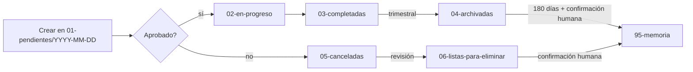

# Organización por estados y fechas

Canon de organización para **todas las secciones que acumulan documentos** con el tiempo. Objetivos: soportar miles de archivos sin perder navegabilidad, reducir los archivos visibles por nivel del árbol, permitir búsqueda por **estado** y por **fecha**, y ser predecible para cualquier IA o desarrollador.

Regla dura: [R-17](../PROTOCOLO.md).

## Estructura

```
<seccion>/
├── INDICE.md, _PROTOCOLO.md, _PLANTILLA*.md     ← registros y plantillas (fuera de estados)
├── 01-pendientes/
│   ├── YYYY-MM-DD/        ← carpeta por fecha de creación
│   │   └── slug.md
│   └── …
├── 02-en-progreso/
│   └── YYYY-MM-DD/
├── 03-completadas/
│   └── YYYY-MM-DD/
├── 04-archivadas/
│   └── YYYY-MM-DD/
├── 05-canceladas/
│   └── YYYY-MM-DD/
└── 06-listas-para-eliminar/
    └── YYYY-MM-DD/
```

### Reglas

1. **Carpeta de estado** = estado actual del documento (no su historia).
2. **Carpeta de fecha** = `YYYY-MM-DD` de **creación** del documento (campo `fecha` / `created` / `proposed_at` del frontmatter). Se conserva al moverse de estado; nunca se renombra.
3. **Nombre de archivo** = `slug.md` (kebab, 2–6 palabras), único dentro de su carpeta de fecha. El identificador global es el `id` del frontmatter (`YYYYMMDD-NNN-slug`, `MEJ-YYYYMMDD-slug`, `EVO-YYYYMMDD-slug`, `AUD-YYYYMMDD-slug`, `ADR-NNN`).
4. **Cambio de estado = mover el archivo** a la carpeta de estado correspondiente (conservando la carpeta de fecha) **y** actualizar `status` en frontmatter en el mismo acto. Herramienta: [`decisiones-pendientes`](../35-herramientas/autorizadas/decisiones-pendientes.md) mueve y marca automáticamente.
5. **Citación:** dentro de docs, citar fichas de colas por `id` (no por ruta): la ruta cambia con el estado. Las rutas se citan solo para docs estables (registros, `03-completadas`+).
6. **El árbol es el índice:** los `INDICE.md` de sección no mantienen tablas de fichas; describen la estructura y apuntan a las plantillas. Vista viva de pendientes: `python3 docs/scripts/decisiones/decisiones.py scan`.

(En Windows: `py -3` en lugar de `python3`.)

## Estados

| Carpeta | Significado |
|---------|-------------|
| `01-pendientes` | Pendiente de decisión humana; efecto **no** aplicado |
| `02-en-progreso` | Aprobado y en ejecución / activo |
| `03-completadas` | Terminado y verificado |
| `04-archivadas` | Histórico reciente (completado o pospuesto, ya no consultado a diario) |
| `05-canceladas` | Rechazado o cancelado |
| `06-listas-para-eliminar` | Marcado para salir de las colas; pendiente de confirmación humana para pasar a la memoria (R-24: nada se borra) |

## Mapeo `status` de frontmatter ↔ carpeta de estado

| Sección | `01-pendientes` | `02-en-progreso` | `03-completadas` | `04-archivadas` | `05-canceladas` | `06-listas-para-eliminar` |
|---------|-----------------|------------------|------------------|-----------------|-----------------|---------------------------|
| `05-instrucciones` | `draft`, `awaiting_approval` | `approved`, `executing` | `done` | `archivada` | `cancelled` | `para-eliminar` |
| `20-decisiones` (ADR) | `propuesta` | `en-evaluacion` (raro) | `aceptada` | `reemplazada`, `obsoleta` | `rechazada` | `para-eliminar` |
| `40-auditorias` | `pendiente` | `activa` | `cerrada` | `archivada` | `cancelada` | `para-eliminar` |
| `45-mejoras-propuestas` | `pending` | `approved` | `done` | `archivada` | `rejected` | `para-eliminar` |
| `46-evolucion-documentacion` | `pending` | `approved` | `done` | `archivada` | `rejected` | `para-eliminar` |
| `35-herramientas/propuestas` | `pending` | `en-evaluacion` | promovida → **sale** a `autorizadas/` | `archivada` | `rejected` | `para-eliminar` |

Enums completos: [convenciones-frontmatter.md](../00-nucleo/convenciones-frontmatter.md).

## Secciones que acumulan (con estados)

| Sección | Qué acumula |
|---------|-------------|
| `05-instrucciones/` | Instrucciones de tarea |
| `20-decisiones/` | ADR |
| `40-auditorias/` | Auditorías e investigaciones formales |
| `45-mejoras-propuestas/` | Deuda del producto, refactors, **bugs** (`tipo: bug`) |
| `46-evolucion-documentacion/` | Evolución del **sistema documental completo** (ver alcance abajo) |
| `35-herramientas/propuestas/` | Herramientas sugeridas por IA |

## Secciones de referencia (sin estados)

No acumulan documentos de ciclo de vida; son **registros organizados por dominio** y no adoptan estados:

| Sección | Por qué |
|---------|---------|
| `00-nucleo/`, `10-guias/`, `30-manuales/` | Canon y guías estables, pocos archivos |
| `15-rutas/` | Registro de fichas HTTP por área; estado en frontmatter (`activa`/`deprecated`) |
| `25-areas/` | Un `CONTEXTO.md` por área |
| `35-herramientas/autorizadas/` | Registro de herramientas ejecutables |
| `50-sistema-integral/` | Espejo 1:1 del código; replica su árbol, no un ciclo de vida |
| `90-archivo/` | Archivo profundo/legacy y capacitación (el archivo cotidiano es `04-archivadas` por sección) |

## Alcance de `46-evolucion-documentacion` (regla [R-18](../PROTOCOLO.md))

`46-evolucion-documentacion/` almacena **únicamente** propuestas, cambios y mejoras que afectan al **sistema documental completo** (la arquitectura de documentación del ecosistema: pack, taxonomía, convenciones, plantillas, procesos, metodología). **No** almacena documentación funcional de un proyecto, módulo o feature.

| Carpeta | Propósito correcto |
|---------|--------------------|
| `46-evolucion-documentacion/` | Mejoras globales al sistema documental, estructura, convenciones, organización y metodología |
| Resto del pack (05, 15, 25, 45, 50…) | Cambios, instrucciones y documentación funcional de un proyecto, módulo o feature |

**Prohibido:** mover documentos de proyecto hacia `46` ni generar documentación funcional dentro de `46`. Bugs e investigaciones **no** son evolución documental: bug → `45` (`tipo: bug`); investigación → `40`.

## Flujo de estado típico



## Verificación

- El validador (`scripts/validar-documentacion.py`) exige las carpetas de estado en las secciones acumulativas y chequea consistencia `status` ↔ carpeta (WARN).
- [`decisiones-pendientes`](../35-herramientas/autorizadas/decisiones-pendientes.md) mueve archivos entre estados al aplicar decisiones.
