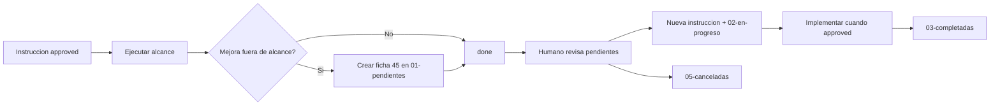

# Protocolo — mejoras y deuda técnica propuestas

## Rol

**Bandeja de salida** para que la IA registre deudas técnicas, refactors, mejoras o **bugs** detectados **durante una instrucción aprobada**, sin implementarlos ni desviar el alcance.

Evita sobre-ingeniería: lo solicitado se ejecuta; lo demás queda documentado para decisión humana.

## Árbol (R-17)

```
45-mejoras-propuestas/
├── 01-pendientes/YYYY-MM-DD/   ← pending
├── 02-en-progreso/YYYY-MM-DD/  ← approved (instrucción derivada)
├── 03-completadas/YYYY-MM-DD/  ← done
├── 04-archivadas/YYYY-MM-DD/   ← archivada (pospuestas antiguas)
├── 05-canceladas/YYYY-MM-DD/   ← rejected
└── 06-listas-para-eliminar/    ← para-eliminar
```

Archivo: `MEJ-YYYYMMDD-slug.md` en la carpeta de fecha de creación. Cambio de estado = mover + actualizar `status`.

## Reglas duras

1. **Solo registrar, nunca ejecutar** una propuesta en `45-mejoras-propuestas/` hasta que el humano la convierta en instrucción `approved`.
2. **Cuándo registrar:** algo está fuera de `alcance` / `Alcance excluido` de la instrucción actual y no es bloqueante para cerrarla.
3. **Cuándo NO registrar:** ya está en el pedido; es bug del alcance actual; es hallazgo que requiere auditoría formal → usar `40-auditorias/02-en-progreso/`.
4. **Creación IA:** solo al **cerrar** una instrucción (`status: done`) o en sección Resultado; máx. **3 propuestas** por instrucción (en `01-pendientes/YYYY-MM-DD/`).
5. **Lectura IA:** **no** listar ni volcar `45-mejoras-propuestas/` en tareas normales. Excepción: instrucción explícita de revisión del backlog.
6. **Humanos:** revisan pendientes, enriquecen la ficha, aprueban (→ instrucción derivada + `02-en-progreso/`), posponen o rechazan (`05-canceladas/`).
7. **Estado inicial (R-16):** una ficha `pending` con bloque **Decisión a tomar** afirma que la mejora **no está implementada**. Si el humano aprueba en el momento y se implementa, la ficha se emite `approved` con `instruction_derivada` y **sin** bloque. Nunca `pending` + ya implementado.
8. **Bugs:** un bug detectado fuera de alcance se registra aquí con `tipo: bug` (misma plantilla, sección Mejora propuesta = corrección propuesta).

## Diferencia con otras carpetas

| Carpeta | Qué va ahí |
|---------|------------|
| `35-herramientas/propuestas/` | Scripts, comandos, snippets reutilizables |
| `40-auditorias/` | Investigación formal con método y hallazgos |
| **`45-mejoras-propuestas/`** | Deuda técnica, refactor, mejora de diseño, **bug** **fuera de alcance** |
| `46-evolucion-documentacion/` | Solo sistema documental completo (R-18) |
| `05-instrucciones/` | Trabajo **aprobado** a ejecutar |

## Flujo



## Fichas

- Plantilla: [_PLANTILLA-propuesta.md](_PLANTILLA-propuesta.md)
- Revisión humana: [_PLANTILLA-revisar-propuesta.md](_PLANTILLA-revisar-propuesta.md)
- Registrar id en `mejoras_propuestas` del frontmatter de la instrucción origen.

## IA — prohibido

- Implementar refactor “de paso” no pedido.
- Ampliar alcance de la instrucción sin aprobación humana.
- Crear propuestas sin evidencia (`path:línea` o referencia concreta).
- Mover fichas de proyecto a `46-evolucion-documentacion/` (R-18).

Ver [mejoras-propuestas-ia.md](../10-guias/mejoras-propuestas-ia.md) · [organizacion-estados-fechas.md](../10-guias/organizacion-estados-fechas.md).
