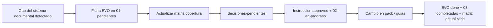

# Protocolo — evolución documental (46)

## Rol

**Bandeja meta** para registrar lo que **falta en el sistema documental completo** (pack, taxonomía, convenciones, plantillas, procesos, metodología del ecosistema) a medida que evolucionan los proyectos. No sustituye la deuda de producto ni las auditorías formales.

**Regla de oro (R-18):** 46 = meta-documentación del sistema documental completo; 45 = deuda del **producto** documentada (incluidos bugs).

> **En un proyecto adoptado, la 46 es un buzón de propuestas hacia el pack fuente (uxyngraphar).** Una EVO aprobada no se ejecuta editando el núcleo local: se implementa en el pack, se publica una versión y el proyecto la recibe al actualizar. Mientras tanto hay dos vías, las dos decididas por una persona (R-25):
>
> - **Usarla ya en este proyecto:** `python3 docs/scripts/ajustes.py crear --evo EVO-ID --a <archivo del núcleo> --texto regla.md` crea un ajuste en `97-ajustes-locales/` que el agente sigue y que ninguna actualización pisa. Guía: [ajustes-locales.md](../10-guias/ajustes-locales.md).
> - **Hacerla llegar al pack:** `python3 docs/scripts/feedback.py previsualizar` muestra lo que saldría y `feedback.py enviar` lo manda al receptor oficial, el backend de uxyngraphar (apagado por defecto; se activa respondiendo «Sí» a la pregunta del instalador o del actualizador, o con `feedback.py activar`; con el envío activo, las fichas nuevas o cambiadas salen solas al terminar un `instalar` o `actualizar` hecho por una persona, nunca desde CI, ganchos ni el agente). Sin servidor: `python3 docs/scripts/exportar-evo.py --salida propuestas-evo.md --marcar` genera un informe para mandarlo a mano. Guía: [envio-sugerencias.md](../10-guias/envio-sugerencias.md).

## Alcance — definición oficial (anti-ambigüedad)

| Carpeta | Propósito correcto |
|---------|--------------------|
| `46-evolucion-documentacion/` | **Únicamente** propuestas, cambios y mejoras que afectan al **sistema documental completo** (arquitectura de documentación del ecosistema): estructura, convenciones, organización, plantillas, metodología, procesos del pack |
| Documentación del proyecto (05, 15, 25, 45, 50…) | Cambios, instrucciones y documentación **funcional** de un proyecto, módulo o feature específico |

**El ejecutor de IA nunca** debe:

- Mover documentos de proyecto hacia `46-evolucion-documentacion/`.
- Generar documentación funcional de un proyecto dentro de `46`.
- Tratar mejoras de documentación de un módulo específico como fichas `EVO-*`.

Las mejoras de documentación de un proyecto/módulo son trabajo de producto: se ejecutan con instrucción `mejorar-docs` en `05-instrucciones/` y tocan `25-areas/`, `15-rutas/`, `50-sistema-integral/`, etc.

## Árbol (R-17)

```
46-evolucion-documentacion/
├── 01-pendientes/YYYY-MM-DD/   ← pending
├── 02-en-progreso/YYYY-MM-DD/  ← approved (instrucción derivada)
├── 03-completadas/YYYY-MM-DD/  ← done
├── 04-archivadas/YYYY-MM-DD/   ← archivada
├── 05-canceladas/YYYY-MM-DD/   ← rejected
└── 06-listas-para-eliminar/    ← para-eliminar
```

`matriz-cobertura-proyectos.md` y las plantillas viven en la raíz de la sección (registros, fuera de estados).

## Reglas duras

1. **Solo registrar, nunca ejecutar** hasta instrucción `approved` derivada (o cambio humano directo en la plantilla del pack fuente).
2. **Cuándo registrar:** falta guía/proceso/taxonomía del **sistema documental** para cubrir un tipo de proyecto; gap detectado en adopción o revisión de [`matriz-cobertura-proyectos.md`](matriz-cobertura-proyectos.md).
3. **Cuándo NO registrar:** refactor de código → `45-mejoras-propuestas/`; bug → `45` (`tipo: bug`); script reutilizable → `35-herramientas/propuestas/`; investigación → `40-auditorias/`; docs de un módulo concreto → instrucción `mejorar-docs`.
4. **Creación IA:** al **cerrar** instrucción (`status: done`) o revisión humana; máx. **2 fichas** por instrucción (`evolucion_documentacion` en frontmatter), en `01-pendientes/YYYY-MM-DD/`.
5. **Lectura IA:** **no** volcar `46-evolucion-documentacion/` en tareas normales. Excepción: revisión de pendientes o instrucción de revisión de cobertura.
6. **Humanos:** revisan pendientes y matriz; aprueban → instrucción derivada + `02-en-progreso/`; posponen o rechazan (`05-canceladas/`).
7. **Estado inicial (R-16):** una ficha `pending` con bloque **Decisión a tomar** afirma que el cambio del pack **no está aplicado**. Si el humano aprueba en el momento, la ficha se emite `approved`/`done` con `instruction_derivada` y **sin** bloque. Nunca `pending` + ya aplicado.

## Diferencia con otras carpetas

| Carpeta | Qué va ahí |
|---------|------------|
| **`46-evolucion-documentacion/`** | Cambios al **sistema documental completo**: estructura, taxonomía, plantillas, convenciones, procesos (R-18) |
| `45-mejoras-propuestas/` | Deuda técnica / refactor / bug del **producto** fuera de alcance |
| `35-herramientas/propuestas/` | Scripts y herramientas reutilizables |
| `40-auditorias/` | Investigación formal con hallazgos |
| `05-instrucciones/` | Trabajo **aprobado** a ejecutar (incluye docs funcionales del proyecto) |

## Flujo



## Cadencia humana

### Adopción (al cerrar instrucción adopción)

- [ ] Revisar [matriz-cobertura-proyectos.md](matriz-cobertura-proyectos.md) fila a fila
- [ ] Marcar **C** / **P** / **F** según el repo real
- [ ] Crear 0–2 fichas `EVO-*` si **F** o mejora general del sistema documental (`evolucion_documentacion` en instrucción)
- [ ] Revisión de pendientes [`decisiones-pendientes`](../35-herramientas/autorizadas/decisiones-pendientes.md) si hay pendientes

### Trimestral (recomendado)

- [ ] Revisar pendientes 46 + matriz; cerrar o posponer fichas antiguas
- [ ] Vaciar `05-canceladas/` obsoletas; mover `done` antiguas a `04-archivadas/`
- [ ] Completar `instruction_derivada` pendientes tras aprobar en revisión de pendientes
- [ ] Actualizar matriz al marcar EVO `done`
- [ ] Registrar nuevo gap si el tipo de proyecto cambió (monorepo, multi-repo, etc.)

Ver [ciclo-vinculante.md](../00-nucleo/ciclo-vinculante.md) · [mejoras-propuestas-ia.md](../10-guias/mejoras-propuestas-ia.md) (tabla 45 vs 46) · [organizacion-estados-fechas.md](../10-guias/organizacion-estados-fechas.md).
