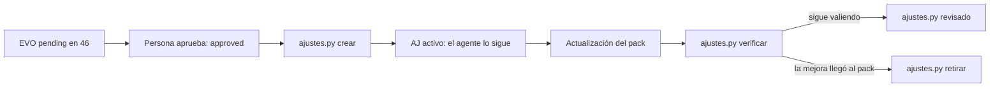

# Protocolo — ajustes locales (97)

## Rol

Capa del **proyecto** encima del núcleo (R-25). Permite usar ya una mejora del sistema documental (ficha `EVO-*` de `46-evolucion-documentacion/`) sin esperar a que llegue al pack y **sin editar el núcleo** (R-20). El núcleo se sigue reemplazando entero al actualizar; los ajustes son contenido del proyecto (clase C) y ninguna actualización los toca.

## Ciclo

## Reglas duras

1. **Solo desde una EVO aprobada** (`approved` o `done`). Sin aprobación humana no hay ajuste (R-16).
2. **Solo personas** crean, revisan y retiran ajustes, siempre con `scripts/ajustes.py`. El agente los **lee y los sigue**; no los escribe.
3. **Precedencia:** si un ajuste activo contradice al archivo que complementa, manda el ajuste, solo en este proyecto. Nada más del núcleo cambia.
4. **Qué puede complementar:** archivos del pack dentro de `docs/` (reglas, protocolos, guías, plantillas). Nunca `95-memoria/`, otro ajuste ni una ficha de las colas.
5. **Huella:** cada ajuste guarda la huella del archivo que complementa. Si una actualización lo cambia, `ajustes.py verificar` lo marca «por revisar» (también `doctor.py`).
6. **Retiro:** cuando el CHANGELOG del pack cita la EVO, la mejora ya está en el núcleo: se retira el ajuste (queda como historia con `status: retirado`).

## Frontmatter

| Campo | Notas |
|-------|-------|
| `id` | `AJ-AAAAMMDD-slug` (= nombre del archivo) |
| `status` | `activo` \| `retirado` |
| `evo` | id de la ficha EVO de origen |
| `aplica_a` | archivos del pack que complementa (relativos a `docs/`) |
| `huellas` | `ruta@huella` de cada archivo al crear o revisar el ajuste |
| `creado`, `aprobado_por`, `retirado`, `motivo_retiro` | trazabilidad |
