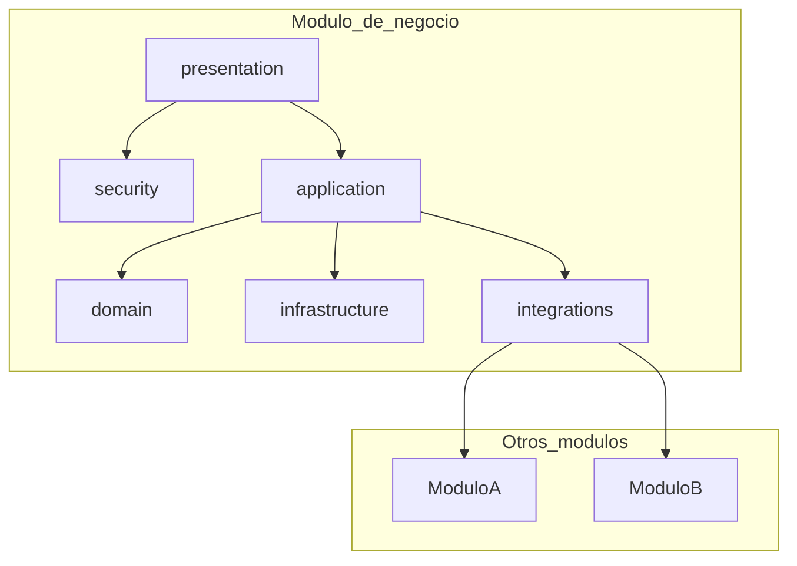

# Arquitectura del servidor

Describe **capas**, la carpeta de **integraciones** entre módulos y reglas de dependencia. Adapta nombres de carpetas y rutas al stack del proyecto.

## Glosario de capas (orientativo)

| Carpeta | Rol |
|---------|-----|
| `presentation/` | Entrada HTTP: rutas, códigos de estado, serialización. Sin reglas de negocio pesadas. |
| `security/` | Autorización o políticas **específicas del recurso** (además de las globales). |
| `sanitization/` | Limpieza o normalización que no encaja solo en validación de entrada. |
| `application/` | Casos de uso: orquestan dominio, puertos/repositorios e **integraciones**. |
| `domain/` | Entidades, value objects, reglas puras. Sin dependencias de framework ni de persistencia. |
| `infrastructure/` | Implementación de puertos (BD, clientes HTTP, colas, etc.). |
| `contracts/` | DTOs, comandos y queries compartidos entre capas de entrada y aplicación. |
| **`integrations/`** | **Único lugar** autorizado para llamar a otros módulos o APIs externas. Métodos con nombres estables y pocos. |

### Regla de oro

- `application/*` **no** importa servicios de otros módulos directamente.
- Importa **`../integrations/<dominio>.integration`** (o el adaptador equivalente del proyecto).

## Dependencias permitidas

## Cliente (equivalente conceptual)

- Cliente HTTP tipado por dominio bajo la estructura definida en el canon del cliente.
- **No** importar UI o estado de otro dominio salvo componentes compartidos o capa `common/`.
- Estado remoto: librería de caché/consultas acordada en el proyecto.
- Manejo de errores en rutas y en la capa de datos.

## Contratos API

- Fuente humana: `docs/15-rutas/`.
- Fuente automática: especificación OpenAPI/Swagger del servidor (ruta según el proyecto).
- Al cambiar contratos públicos: actualizar fichas y regenerar tipos en el cliente si aplica.

## Código transversal (`common` o equivalente)

- **No** debe importar desde módulos de negocio.
- Configuración, logging, acceso a BD y filtros globales viven aquí.
- Validación de variables de entorno centralizada; fallar pronto en arranque.

## Adopción progresiva

1. Nuevos módulos siguen `plantilla-modulo.md`.
2. Cruces entre dominios solo por `integrations/`.
3. Código legado se refactoriza por tandas.
4. Extracción a otro repo: contratos HTTP versionados + pruebas en el límite.

## Referencia

Ver [plantilla-modulo.md](plantilla-modulo.md). Sustituir `<modulo-ejemplo>` por un módulo real del proyecto.
