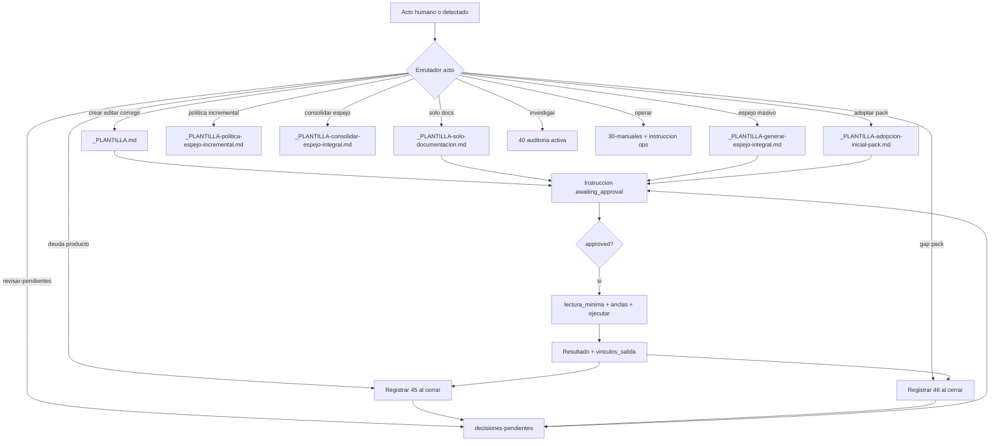

# Ciclo vinculante — actos del proyecto

**Manifiesto único** que enlaza cada acto (crear, editar, corregir, mejorar, auditar…) con su contexto mínimo para la IA. Complementa [eficiencia-ia.md](eficiencia-ia.md) y [estrategia-instrucciones.md](estrategia-instrucciones.md) **sin duplicar reglas**: aquí solo el **grafo de enrutamiento**.

## Regla de vínculo

Ningún acto queda suelto. Toda acción termina en:

1. **Instrucción** `approved` en `05-instrucciones/` (contrato con `acto`, `vinculos_entrada`, `vinculos_salida`), **o**
2. **Herramienta autorizada** (`35-herramientas/autorizadas/`, alcance explícito), **o**
3. **Excepción documentada:** solo lectura, errata de una línea, actualizar instrucción ya aprobada a petición explícita.

## Diagrama integral

## Tabla enrutadora

| acto | Plantilla / destino | Lectura IA típica | Escritura obligatoria | Colas al cierre |
|------|----------------------|-------------------|----------------------|-----------------|
| `crear` | [_PLANTILLA.md](../05-instrucciones/_PLANTILLA.md) | `lectura_minima` + CONTEXTO | Código + operativa + `espejo_actualizar` | 45 ≤3, 46 ≤2, 35 opcional |
| `editar` | _PLANTILLA.md | Idem | Idem | Idem |
| `corregir` | _PLANTILLA.md | Idem + audit si investigación | Fix + sync docs tocadas | 45 si deuda detectada |
| `mejorar-docs` | [_PLANTILLA-solo-documentacion.md](../05-instrucciones/_PLANTILLA-solo-documentacion.md) | Solo paths citados | Operativa ± espejo declarado | 46 si gap pack |
| `auditar` | [_PLANTILLA.md](../40-auditorias/_PLANTILLA.md) en `02-en-progreso/YYYY-MM-DD/` | Audit citada + CONTEXTO | Hallazgos + promociones | Promoción → canon/ADR/ficha |
| `adoptar` | [_PLANTILLA-adopcion-inicial-pack.md](../05-instrucciones/_PLANTILLA-adopcion-inicial-pack.md) | Guías adopción | Áreas, rutas, matriz 46 | EVO si gaps |
| `operar` | Instrucción + `30-manuales/` | Manual citado | Según runbook | — |
| `revisar-pendientes` | [decisiones-pendientes](../35-herramientas/autorizadas/decisiones-pendientes.md) | Ficha autorizada | Status/checkboxes + **mover entre estados** | Instrucción derivada |

Todo documento de cola nace en `01-pendientes/YYYY-MM-DD/` y se mueve de carpeta de estado al cambiar `status` (R-17).

## Campos de vínculo (instrucción)

En frontmatter de cada instrucción:

| Campo | Rol |
|-------|-----|
| `acto` | Enrutador: `crear` \| `editar` \| `corregir` \| `mejorar-docs` \| `auditar` \| `adoptar` \| `operar` \| `revisar-pendientes` |
| `vinculos_entrada` | Origen: `EVO-*`, `MEJ-*`, `AUD-*`, instrucción previa, issue/PR |
| `vinculos_salida` | **Al cerrar:** ids + paths de docs tocados |
| `evolucion_documentacion` | Fichas `46-evolucion-documentacion/` creadas (máx. 2) — solo sistema documental completo (R-18) |

Sección en cuerpo: **Vínculos del acto** (entrada, contexto mínimo, salida esperada). Fichas de colas se citan por `id`: las rutas cambian al moverse entre carpetas de estado (R-17).

## Presupuesto IA por acto

| acto | Docs máx. (incluye AGENTES + instrucción) | Código máx. |
|------|-------------------------------------------|-------------|
| crear / editar / corregir | 8 total (ver eficiencia-ia) | 5 anclas |
| mejorar-docs | 6 | 0 |
| auditar | 8 | según audit |
| adoptar | 12 (instrucción adopción) | según alcance |
| revisar-pendientes | 2 (ficha herramienta) | según ficha |

## Diferencia 45 vs 46 (colas al cierre)

| Cola | Qué registra |
|------|--------------|
| `45-mejoras-propuestas/` | Deuda del **producto** fuera de alcance: refactors, mejoras de diseño, **bugs** (`tipo: bug`) |
| `46-evolucion-documentacion/` | Mejoras al **sistema documental completo** (pack, taxonomía, convenciones, plantillas, metodología) — nunca docs funcionales de un proyecto (R-18) |

Ver [mejoras-propuestas-ia.md](../10-guias/mejoras-propuestas-ia.md) · [_PROTOCOLO 46](../46-evolucion-documentacion/_PROTOCOLO.md) · [organizacion-estados-fechas.md](../10-guias/organizacion-estados-fechas.md).

## Guía operativa extendida

Ejemplos y matriz acto × carpeta: [ciclo-integral-actos.md](../10-guias/ciclo-integral-actos.md).
