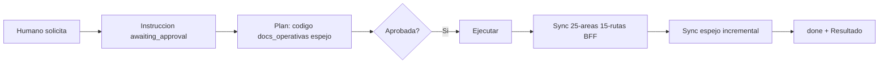

# Estrategia — documentación centrada en instrucciones

Canon estratégico del **pack cliente**: **toda documentación nace, se aprueba y se cierra desde instrucciones humanas** (`05-instrucciones/`). Este repo es **autocontenido**; no asume que el pack servidor viva en la misma carpeta.

## Repo aislado (default)

| Regla | Detalle |
|-------|---------|
| Alcance docs | Solo `docs/` de **este** repositorio frontend |
| API backend | Contratos por **`id`** vía [registro-ids-compartidos.md](registro-ids-compartidos.md); no duplicar fichas HTTP del servidor |
| Ref al otro repo | URL/path externo en registro o `configuracion-proyecto.md`; no paths locales cruzados |
| Monorepo | Opcional; ver [monorepo-docs-fusionados.md](../10-guias/monorepo-docs-fusionados.md) |

## Origen único

| Regla | Detalle |
|-------|---------|
| Sin instrucción `approved` | No editar código ni documentación (salvo excepciones en [PROTOCOLO.md](../PROTOCOLO.md)) |
| Pedido humano | Siempre materializado en instrucción antes de ejecutar |
| Cierre | Instrucción → `done` + sección **Resultado** con docs tocadas |

Flujo detallado: [flujo-instrucciones-documentacion.md](../10-guias/flujo-instrucciones-documentacion.md) · Enrutador: [ciclo-vinculante.md](ciclo-vinculante.md).

## Capas documentales

| Capa | Carpetas | Lectura IA | Escritura | Excepción sin instrucción |
|------|----------|------------|-----------|---------------------------|
| **Operativa** | `25-areas/`, `15-rutas/` (BFF), `20-decisiones/`, `40-auditorias/` | Habitual vía `lectura_minima` | Cierre de instrucción / mismo PR | No |
| **Espejo** | `50-sistema-integral/` | **Solo si citado** (`espejo_leer` o `lectura_minima`; default 0) | **Incremental** vía `espejo_actualizar` | No |
| **Herramientas** | `35-herramientas/autorizadas/`, `propuestas/<estado>/` | Autorizada: ficha citada; propuestas: humano revisa | Autorizadas: humano; propuestas: IA en instrucción (`01-pendientes/`) | **Sí** (solo autorizadas) |
| **Cola mejoras** | `45-mejoras-propuestas/<estado>/YYYY-MM-DD/` | **No leer** (salvo revisión de pendientes) | Al cerrar instrucción; máx. 3 en `01-pendientes/` | No |
| **Evolución pack** | `46-evolucion-documentacion/<estado>/YYYY-MM-DD/` | **No leer** (salvo revisión de pendientes/cobertura) | Al cerrar; máx. 2 en `01-pendientes/` — solo sistema documental completo (R-18) | No |

Estados y fechas: [organizacion-estados-fechas.md](../10-guias/organizacion-estados-fechas.md) (R-17).

### Operativa

Capacitación UI/BFF: CONTEXTO, fichas BFF propias, refs a ids del API servidor. Es lo que la IA lee para **implementar frontend**.

### Espejo

Mapa humano del scaffolding UI (mismas rutas que el código, solo `.md`). La IA **escribe** paths concretos al cerrar; **no recorre** el árbol salvo necesidad explícita. En el espejo, citar **id** de endpoint; no pegar OpenAPI del backend.

### Herramientas

Scripts y flujos repetibles del frontend. **Autorizadas:** el humano crea la ficha; la IA ejecuta sin instrucción nueva si el alcance coincide. **Propuestas:** la IA sugiere; el humano promueve o rechaza.

## Reglas del espejo

### Lectura (referencia visual)

- Default: **0 archivos** del espejo en tareas normales.
- Permitido: paths en `espejo_leer` o `lectura_minima` (máx. ~3).
- Casos típicos: onboarding (“¿dónde está X?”), instrucción `generar-espejo-integral`.
- **Prohibido:** glob/list masivo, “orientarse” leyendo el espejo, volcar índices del espejo.

### Escritura (sync incremental)

Toda instrucción con `anclas_codigo` debe declarar `espejo_actualizar`:

```
src/app/dashboard/page.tsx
  → docs/50-sistema-integral/src/app/dashboard/page.md
  → docs/50-sistema-integral/src/app/dashboard/README.md (si afecta la carpeta)
```

| Evento | Acción espejo |
|--------|---------------|
| Carpeta UI nueva | `README.md` en espejo |
| Page/component/handler nuevo | `<nombre>.md` |
| Cambio de comportamiento | Actualizar `.md` (sin pegar código) |
| Refactor de ruta | Mover/renombrar `.md` (en alcance) |
| Typos sin cambio de rol | Opcional omitir espejo |

Generación masiva inicial: [_PLANTILLA-generar-espejo-integral.md](../05-instrucciones/_PLANTILLA-generar-espejo-integral.md) — **solo proyectos pequeños o espejo vacío**.  
Proyectos medianos/grandes: [_PLANTILLA-politica-espejo-incremental.md](../05-instrucciones/_PLANTILLA-politica-espejo-incremental.md) + sync en cada [_PLANTILLA.md](../05-instrucciones/_PLANTILLA.md); doc general → [_PLANTILLA-consolidar-espejo-integral.md](../05-instrucciones/_PLANTILLA-consolidar-espejo-integral.md).  
Mantenimiento diario: [_PLANTILLA.md](../05-instrucciones/_PLANTILLA.md) + `espejo_actualizar` + [`registro-cobertura-espejo.md`](../50-sistema-integral/registro-cobertura-espejo.md).

## Ciclo por solicitud humana



## Campos de instrucción (resumen)

| Campo | Uso |
|-------|-----|
| `lectura_minima` | Docs operativos a leer |
| `anclas_codigo` | Código UI/BFF a leer/editar |
| `espejo_actualizar` | `.md` del espejo a crear/actualizar al cerrar |
| `espejo_leer` | Casi siempre `[]`; solo consulta previa al mapa |
| `herramientas_propuestas` | Ids en `35-herramientas/propuestas/` creados al cerrar |
| `mejoras_propuestas` | Ids en `45-mejoras-propuestas/` — deuda fuera de alcance (máx. 3) |
| `ampliacion_factor` · `ampliacion_justificacion` | Solo si >5 archivos de código es sumamente necesario: 1.5–2× con aprobación humana (R-21) |
| `fraccion_de` · `depende_de` | Fracciones de ≤5 archivos cuando la ampliación no es necesaria (R-21) |

La instrucción vive en `05-instrucciones/<estado>/YYYY-MM-DD/<slug>.md` y se mueve de estado al cambiar `status` (R-17).

Ver plantilla: [_PLANTILLA.md](../05-instrucciones/_PLANTILLA.md). Convenciones: [convenciones-frontmatter.md](convenciones-frontmatter.md).

## Herramientas

- **Autorizadas:** humano crea; IA ejecuta sin instrucción si ficha `authorized` y alcance coincide.
- **Propuestas:** IA sugiere; humano promueve a autorizadas o rechaza.

### Cola de mejoras (`45-mejoras-propuestas/`)

Deuda técnica, refactors y **bugs** detectados **fuera del alcance** de la instrucción. La IA **registra** al cerrar (en `01-pendientes/YYYY-MM-DD/`); el humano **enriquece, aprueba o rechaza** y deriva una instrucción nueva. Anti-desvío: no implementar “de paso”.

Ver [35-herramientas/_PROTOCOLO.md](../35-herramientas/_PROTOCOLO.md).

## Referencias

- Presupuesto tokens: [eficiencia-ia.md](eficiencia-ia.md)
- Checklist PR: [sync-documentacion-pr.md](../10-guias/sync-documentacion-pr.md)
- Protocolo espejo: [50-sistema-integral/_PROTOCOLO.md](../50-sistema-integral/_PROTOCOLO.md)
- Sync multi-repo: [sync-multi-repo.md](../10-guias/sync-multi-repo.md)
