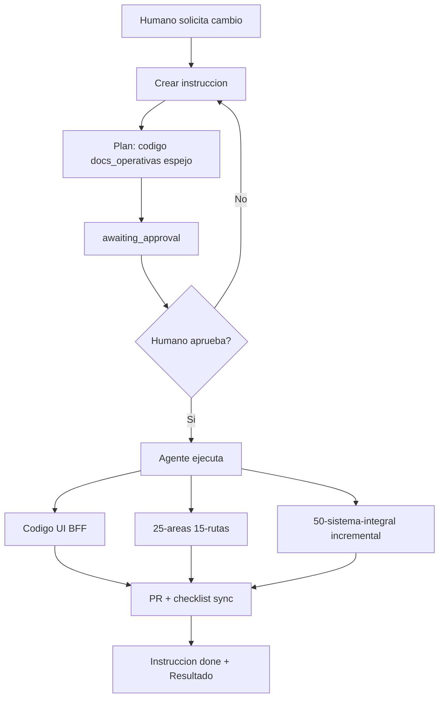
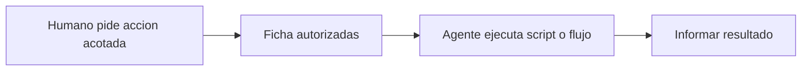

# Flujo — instrucciones y documentación (cliente)

Guía para humanos y agentes: **toda documentación nace de instrucciones aprobadas**.

## Empieza aquí

| Recurso | Uso |
|---------|-----|
| [tarjeta-referencia-humana.md](tarjeta-referencia-humana.md) | Referencia rápida humana |
| [!00_franco-documentacion-practica.html](../!00_franco-documentacion-practica.html) | Mapa visual del flujo (cliente) |

Canon: [estrategia-instrucciones.md](../00-nucleo/estrategia-instrucciones.md). **Enrutador de actos:** [ciclo-vinculante.md](../00-nucleo/ciclo-vinculante.md) · Ejemplos: [ciclo-integral-actos.md](ciclo-integral-actos.md).

## Resumen

## Específico frontend

| Campo | En cliente |
|-------|------------|
| `anclas_codigo` | `src/app/`, componentes, BFF |
| `espejo_actualizar` | Misma ruta bajo `50-sistema-integral/` |
| API backend | Citar **id** en `.md`; no duplicar fichas del repo servidor |

## Paso 1 — Solicitud humana

El humano describe el pedido. El agente **no codea ni documenta** todavía.

## Paso 2 — Redactar instrucción

Copiar [`_PLANTILLA.md`](../05-instrucciones/_PLANTILLA.md) → `05-instrucciones/01-pendientes/YYYY-MM-DD/<slug>.md` (R-17).

Rellenar obligatorio:

| Campo | Contenido |
|-------|-----------|
| `lectura_minima` | Docs operativos a leer (CONTEXTO, BFF propios) |
| `anclas_codigo` | Código UI/BFF a inspeccionar/editar |
| `espejo_actualizar` | `.md` del espejo a escribir al cerrar |
| `espejo_leer` | Casi siempre `[]` |

Estado: `awaiting_approval`.

## Paso 3 — Aprobación humana

Revisar plan, alcance, sync documental y paths del espejo. `status: approved` + mover a `02-en-progreso/` (misma carpeta de fecha).

## Paso 4 — Ejecución

Orden recomendado:

1. Código según `anclas_codigo`.
2. Docs operativas (CONTEXTO, `15-rutas/` BFF, índices).
3. Espejo incremental (`espejo_actualizar`).
4. Checklist [sync-documentacion-pr.md](sync-documentacion-pr.md).

**No leer** el espejo completo; solo escribir paths declarados.

## Paso 5 — PR y cierre

- PR incluye código + docs + espejo.
- Instrucción → `done` + mover a `03-completadas/YYYY-MM-DD/` (R-17).
- Rellenar `vinculos_salida`, `mejoras_propuestas` (≤3), `evolucion_documentacion` (≤2) si aplica.
- **Resultado** lista commits, docs operativas y archivos de espejo.
- Revisar bandejas pendientes en [`decisiones-pendientes`](../35-herramientas/autorizadas/decisiones-pendientes.md): instrucciones por aprobar, MEJ, EVO, propuestas de herramienta.

## Casos especiales

| Caso | Plantilla / acción |
|------|---------------------|
| Proyecto mediano+ — adoptar acumulación | `_PLANTILLA-politica-espejo-incremental.md` (una vez) |
| Cada feature UI con espejo | `_PLANTILLA.md` + `espejo_actualizar` + registro |
| Doc general / completar mapa UI | `_PLANTILLA-consolidar-espejo-integral.md` |
| Primera generación del espejo (repo pequeño) | `_PLANTILLA-generar-espejo-integral.md` |
| Typos sin cambio de rol | `espejo_actualizar: []` declarado en alcance |
| Solo lectura / pregunta | Instrucción con `espejo_leer` (1–3 paths), sin código |
| **Solo ejecutar herramienta ya autorizada** | **Sin instrucción nueva** — leer ficha en `35-herramientas/autorizadas/` |
| IA sugiere herramienta nueva | Propuesta en `propuestas/` al cerrar instrucción; humano promueve después |

## Rama: herramienta autorizada (sin instrucción)

Requisitos: ficha `status: authorized`, en INDICE, alcance coincide.

## Qué no hacer

- Documentar fuera de instrucción aprobada.
- Recorrer `50-sistema-integral/` “para orientarse”.
- Duplicar fichas HTTP del backend — usar **id** en [registro-ids-compartidos.md](../00-nucleo/registro-ids-compartidos.md).
- Cerrar instrucción sin actualizar espejo cuando hubo cambios de código relevantes.
- Ejecutar propuestas en `35-herramientas/propuestas/` sin promoción humana.
